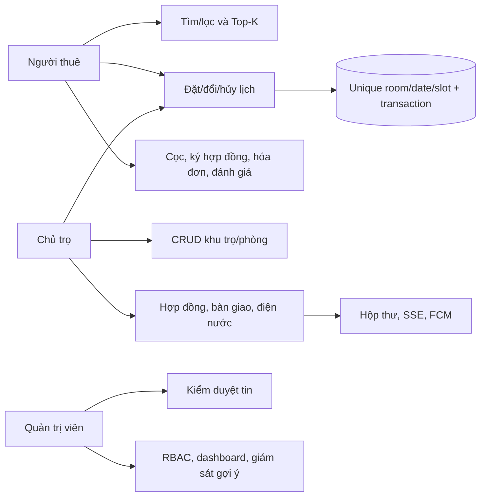
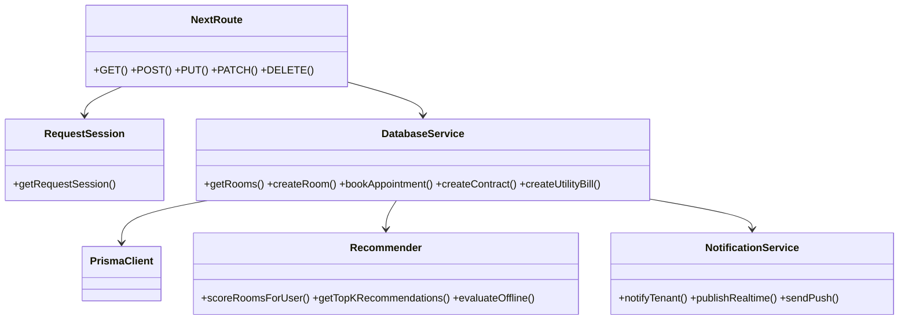
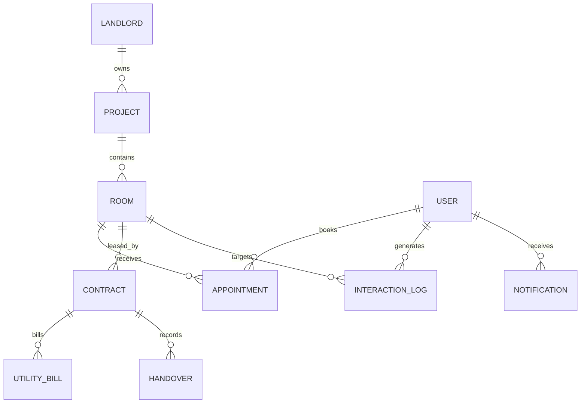

# Tài liệu phân tích và thiết kế tóm tắt

## Tác nhân và Use Case nghiệp vụ

## Lớp dịch vụ thiết kế

## Mô hình dữ liệu trọng tâm

Nguồn chính xác về cột, khóa và quan hệ là `web/prisma/schema.prisma`; sơ đồ này chỉ trình bày các thực thể cốt lõi để đưa vào báo cáo.
